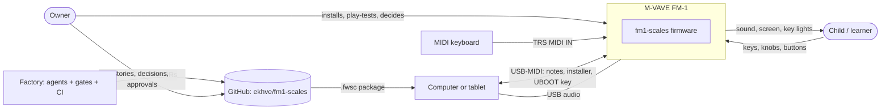
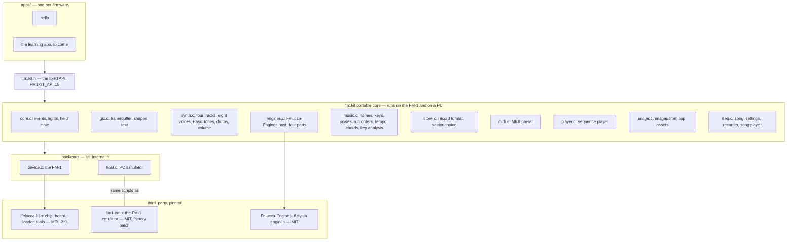
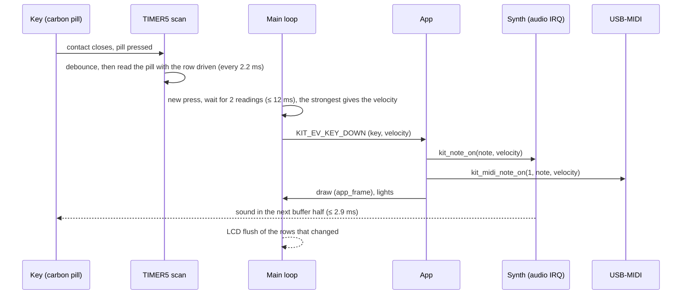
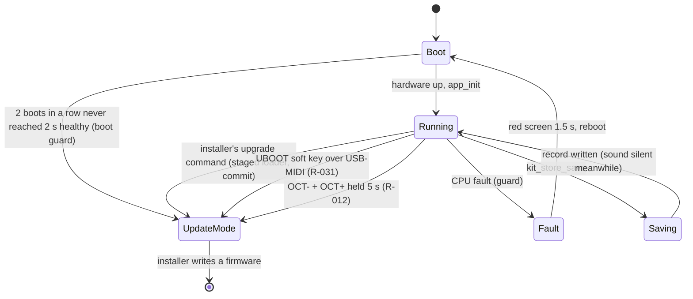
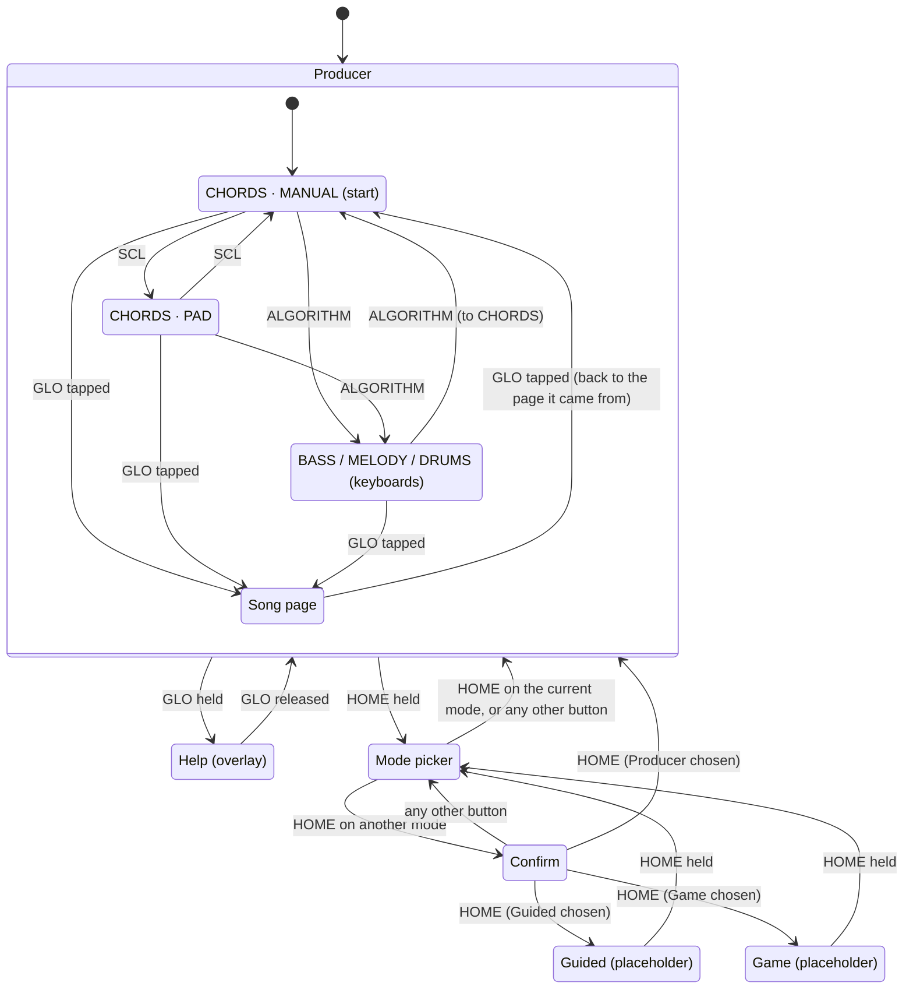
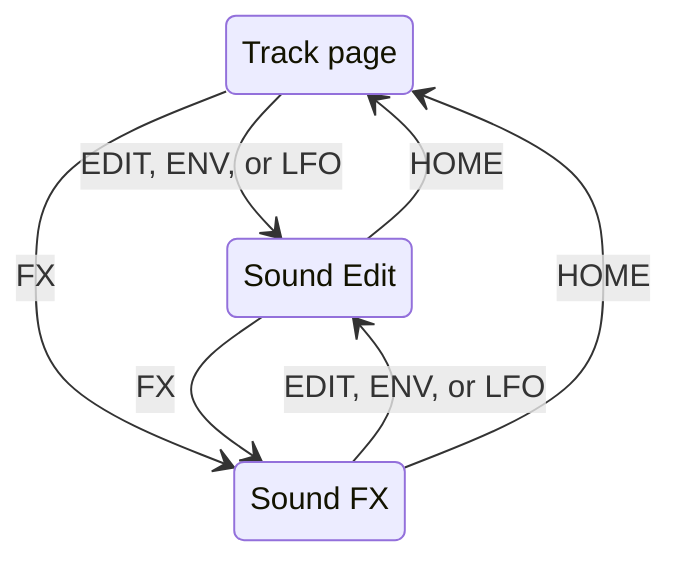
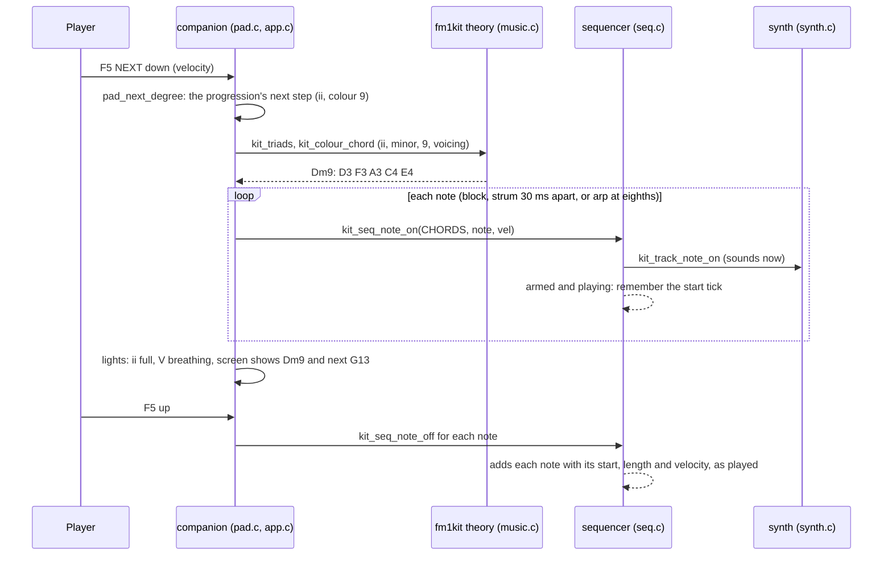
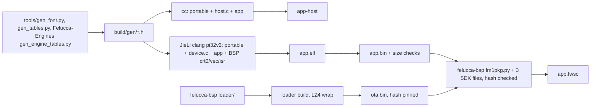
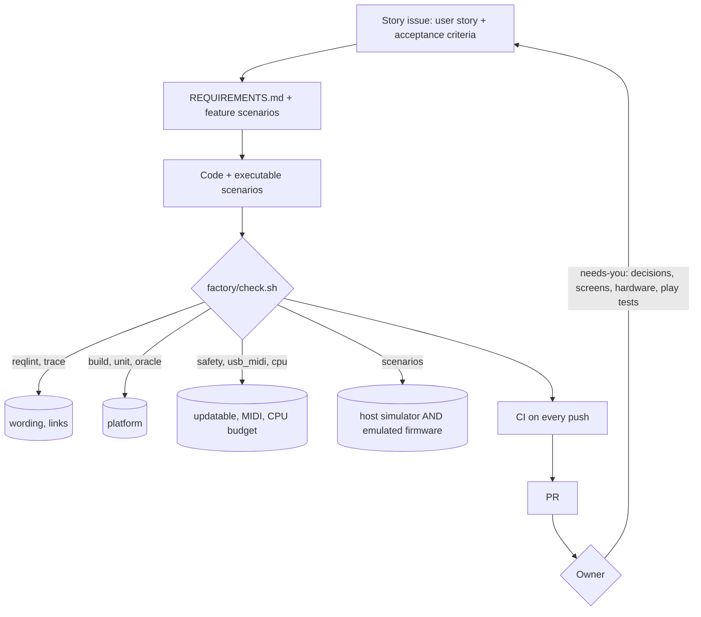

# fm1-scales — Architecture

How the firmware and the factory are built, and why. Interfaces in detail are in `INTERFACES.md`, decisions in
`PLATFORM.md` (D-nnn), requirements in `REQUIREMENTS.md` (R-nnn), hazards in `HAZARDS.md` (HAZ-nn). Diagrams are
Mermaid; GitHub renders them.

## 1. Context

The firmware is the only thing on the FM-1 we change. Everything else on the device (the ROM bootloader, the update
loader we ship unchanged from felucca-bsp, the stock firmware's flash areas) is treated as outside the boundary and
is never written (D-006, D-011, D-022).

## 2. Layers

**Rules that keep it this way.** Apps include `fm1kit.h` only (R-018, `safety.py`). The portable core never touches
hardware; a backend implements `kit_internal.h` (`INTERFACES.md` IF-02). The same portable code is compiled into
both backends, which is why the device's screen must equal the host's pixel for pixel (R-002).

## 3. Runtime on the FM-1

Three contexts, by priority:

| Context | Rate | Does | Must not |
|---|---|---|---|
| TIMER5 interrupt (priority 4) | 10 kHz | Key and encoder scan, LED multiplexing, pill readings (velocity), ms clock, USB poll every 5th tick | Call app code |
| ALNK0 audio interrupt (priority 3) | every 128 frames (2.9 ms) | `kit__synth_render` into the free half of the I2S buffer: Basic voices or the selected engine | Take longer than 2.9 ms (R-015 keeps it under 80 %) |
| Main loop | as fast as it runs | Watchdog, update service and UBOOT checks, OCT-combo timer, MIDI in (TRS ring, USB ring), the player's next note, the song player's notes, the store's paced write, key presses with velocity, app events, `app_frame` every ≥ 10 ms, LCD flush of dirty rows | Block for long: a flash erase stops interrupts for tens of ms, so the store zeroes the audio buffer first |

### A key press

### Modes of the FM-1 with the firmware

`Running` is where an app's own states live. Each app documents its states here when it has them; the `While`
clauses of its requirements name them (playbook §9).

### The companion's states (apps/companion)

What the screen and the keys are doing. The song (four tracks, the loop) runs underneath every state and is never
changed by moving between them.

Orthogonal to these, the transport: **stopped**, **playing**, and **armed** (REC: the current track records while it
plays). The song's key is read again when the song stops (D-034), so pages never move under the hands.

### Producer sound panels

On a pitched Producer track, Sound Edit and Sound FX are alternate panels over the current track page.
The track's playing mode and transport stay active while either panel is open. Held-key releases still reach the
instrument. The panel closes when the player switches tracks or enters a view that takes over the controls.

| Panel | Page order and controls |
| --- | --- |
| Sound Edit | EDIT steps through OSC, FILTER, F.ENV, A.ENV, VOICE, LFO and MOD. SELECT steps in either direction. Hold EDIT to return to OSC. ENV toggles the two envelope pages and LFO opens LFO directly. |
| Sound FX | FX steps through PERFORM, DELAY, REVERB and DIRT. Hold FX to return to PERFORM. SELECT chooses the X/Y pair on PERFORM and changes pages elsewhere. |

Plain EDIT enters the panel when the player releases it. When EDIT is used as a chord for recording or sequencing,
the relevant sequencer interaction takes precedence. On Sound Edit FILTER, the meter reads the selected FMini or
Juno-106 track before the shared effects. Both Juno envelope pages access its shared ADSR. In Sound FX, DELAY and
REVERB expose shared effects plus the current track's send. DIRT acts on the current track.

### An interaction: one finger plays a chord while recording

## 4. Flash

| Range | Owner | We write? |
|---|---|---|
| 0x00000–0x03FFF | Boot area: header, SPL, config | Never |
| 0x04000–0x92FFF | App area: the package's app (ours ~170 KB) | Only by an install |
| 0x93000–0x96FFF | XDATA0: **fm1kit store**, four candidate sectors | Yes: blank or our own sectors only (R-020, D-022) |
| 0x97000–0xDFFFF | Felucca-family data (projects, samples) | Never |
| 0xE0000–0xE4FFF | Update staging (the staged loader) | Only the update entry (ota.c) |
| 0xE5000–0xE6FFF | Felucca-family autosave, drum records | Never |
| 0xE7000–0xE9FFF | Stock SDK system: VM, BTIF | Never |
| 0xEA000–0xFBFFF | Stock firmware's USR area | Never |
| 0xFC000–0xFEFFF | Felucca-family settings | Never |
| 0xFF000–0xFFFFF | key_mac | Never |

The flash driver itself refuses writes outside our two regions (`FM1_FLASH_WRITE_REGIONS` in `device.c`, R-019).

## 5. Build

`tools/build.py` stops on: an image over the app area, RAM or pool over their regions, a loader whose hash differs
from `factory/loader.sha256`, SDK files that are not the tested ones.

## 6. The factory

| Gate | Checks | Fails on |
|---|---|---|
| reqlint | Requirement wording (playbook §6) | A rule violation without a waiver |
| trace | Requirements ↔ scenarios ↔ checks ↔ decisions ↔ hazards; writes `TRACEABILITY.md` | A broken link, an uncited scenario, an unrun automated scenario, a stale matrix |
| build | Both builds, sizes, the loader pin, SDK hashes | Any of them |
| unit | Portable code on the host (`factory/unit/`) | A failed check |
| oracle | music.c vs Sketchpad, 840 answers | One difference |
| safety | Over emulated USB: handshake, UBOOT key, OCT combo both ways; loader pin; apps only use fm1kit.h | Any of them |
| usb_midi | Notes out with velocity ≤ 20 ms, notes in reach the app | Any of them |
| cpu | Every sound, 8 voices, cycle-modelled: interrupts < 80 % (D-091) | One sound over |
| scenarios | Pitch, silence, level ratios, lights, screens; host vs device pixel parity; reboot persistence | One check |
