# fm1-scales — Interfaces

Every boundary the firmware and the factory have, what crosses it, and its nominal and off-nominal events (the
playbook's analysis set: these events feed `When` and `If` requirements). Architecture is in `ARCHITECTURE.md`.

| ID | Interface | Between |
|---|---|---|
| IF-01 | fm1kit API | An app ↔ fm1kit |
| IF-02 | Backend contract | fm1kit portable core ↔ a backend (device, host) |
| IF-03 | Hardware | device backend ↔ felucca-bsp ↔ the FM-1's chip and board |
| IF-04 | Flash | the firmware ↔ the FM-1's 1 MiB NOR flash |
| IF-05 | USB-MIDI | the FM-1 ↔ a computer (notes, the installer, the UBOOT key) |
| IF-06 | TRS MIDI IN | a MIDI instrument → the FM-1 |
| IF-07 | Audio out | fm1kit → the codec |
| IF-08 | Store record | the store ↔ its sectors |
| IF-09 | Factory | scenarios ↔ the host simulator and the emulator |

---

## IF-01 — fm1kit API (`fm1kit/include/fm1kit.h`, FM1KIT_API 42)

The header is the contract; `PLATFORM.md` explains it and records every change (rule 6 of `CLAUDE.md`).

The shared delay tone is set and read with `kit_delay_tone` and `kit_delay_tone_of`. At 127 the delay retains the
original response of its selected type. `kit_delay_ms_of` returns the rounded delay time after the type and
delay line limit are applied.

`kit_reverb_shape` sets the shared room size, damping and pre-delay. `kit_reverb_shape_of` returns those settings.
`kit_reverb_tail_ms_of` reports the tail processing window, excluding pre-delay.

`kit_track_dirt` and `kit_track_dirt_of` control a track's CRUSH, TONE and MIX. DRIVE still comes from the
track's existing send settings. `kit_track_dirt_curve` returns the static transfer for the graph. The actual
tone filter is frequency-dependent.

`kit_perform_fx` overlays one live WAH, DUB, SPACE or DIRT pair on a track. Base send and effect readings stay
available for the editor. Delay timing and feedback are shared while DUB is active.

```mermaid
classDiagram
    class App {
        app_init()
        app_event(kit_event_t)
        app_frame(now_ms)
    }
    class Input {
        KIT_EV_KEY_DOWN/UP(key 0..26, vel)
        KIT_EV_BTN_DOWN/UP(KIT_BTN_*)
        KIT_EV_ENC(KIT_ENC_*, clicks)
        KIT_EV_MIDI_NOTE_ON/OFF, KIT_EV_MIDI_CC
        kit_key_held() kit_btn_held() kit_pot()
    }
    class Screen {
        kit_clear() kit_pixel() kit_rect() kit_rect_outline()
        kit_round_rect() kit_circle() kit_line()
        kit_text() kit_text_width() kit_font_height()
        kit_image(x, y, IMG_NAME, scale)
    }
    class Lights {
        kit_key_light(key, OFF|DIM|ON|BREATH)
        kit_btn_light() kit_lights_off()
    }
    class Sound {
        kit_note_on() kit_note_off() kit_all_notes_off()
        kit_sound(engine, preset) kit_engine_*() kit_preset_*()
        kit_instrument() kit_volume() kit_volume_limit()
        kit_track_sound(track, engine, preset)
        kit_track_note_on() kit_track_note_off() kit_track_notes_off()
        kit_track_bend() kit_track_mod() kit_track_sustain()
        kit_click() kit_tune()
        kit_voices_used() kit_voices_load() kit_voices_stolen()
    }
    class Music {
        KIT_SCALES[] kit_pc() kit_octave() kit_is_white()
        kit_note_name() kit_note_name_in_key()
        kit_scale_has() kit_scale_degree()
        kit_run_order(UP|DOWN|UPDOWN|RANDOM, seed)
        kit_tempo_clamp() kit_beat_ms()
        kit_triads() kit_inversion() kit_quality_sym()
        kit_key_fit() kit_keys_for_notes()
    }
    class Player {
        kit_play_start(notes, n, step_ms, vel, loop)
        kit_play_stop() kit_playing()
        KIT_EV_PLAY_NOTE(note, vel, index), KIT_EV_PLAY_END
    }
    class Midi {
        kit_midi_note_on() kit_midi_note_off() kit_midi_cc()
        kit_midi_connected() kit_midi_realtime()
        KIT_EV_MIDI_BEND, KIT_EV_MIDI_CLOCK(Start, Continue, Stop)
    }
    class Song {
        kit_song_init() kit_song_add() kit_song_add_chord() kit_song_clear()
        kit_seq_play() kit_seq_stop() kit_seq_tick()
        kit_seq_follow() kit_seq_resume() kit_seq_clock_bpm() kit_seq_clock_out()
        kit_seq_metronome() kit_seq_count_in() kit_seq_counting()
        kit_seq_record(track) kit_seq_note_on() kit_seq_note_off()
        KIT_EV_SEQ_BAR(bar)
        kit_song_key() kit_song_lock_key() kit_song_auto_key()
        kit_song_transpose() kit_song_set_tempo() kit_song_set_bars()
    }
    class Store {
        kit_store_load() kit_store_save() kit_store_pending() kit_store_status()
    }
    App ..> Input : events
    App --> Screen
    App --> Lights
    App --> Sound
    App --> Music
    App --> Midi
    App --> Store
    App --> Song
    Song --> Sound
    App --> Player
    App ..> Player : events
    Player --> Sound
```



| Event | Nominal | Off-nominal (each needs an app's answer, playbook §4.4) |
|---|---|---|
| Key down / up | One key, then its release | Two keys at once; a key held for minutes; every key at once; a press too light to read the pill (velocity 100 after 12 ms) |
| Encoder | A few clicks | Spun hard (many clicks in one frame: `delta` can be large) |
| Buttons | One at a time | OCT- + OCT+ together (the platform's update combo after 5 s: apps should not need it) |
| MIDI in | Note on, note off | A note-off that never comes; notes outside the 27 keys; running status; clock bytes mid-message (handled, R-026/R-027) |
| Player | Start, notes one step apart, stop | Started again while playing (restarts from the new sequence); more than `KIT_PLAY_MAX` notes (the first 64 play); a key pressed while it plays (both sound); the store waits until it stops |
| Store | Load at start, save after a change | Nothing saved yet (0); another firmware's data in every sector (`KIT_STORE_ERR_FULL`); power cut during a save (old record survives, R-010) |

## IF-02 — Backend contract (`fm1kit/src/kit_internal.h`)

What every backend implements; the portable core calls nothing else.

| Group | Functions | device.c | host.c |
|---|---|---|---|
| Screen | `kit__fb`, `kit__dirty()` | 240×240 RGB565 in the pool; dirty rows to the LCD after each frame | An array; PPM at the script's snap times |
| Sound | `kit__synth_render()` called by the backend | From the ALNK0 interrupt, 128 frames | 32 samples a step into a WAV |
| Lights | `kit__light_set(id, level)` | The scan's LED arrays (lit / dim / breath) | Recorded; JSON at snap times |
| Input | `kit__core_poll(notes, buttons, enc, vel)` | Each main-loop pass, a press once its velocity is known | Each 10 ms step, from the script |
| Store | `kit__flash_read/erase/write(sector, …)` | felucca-bsp flash driver at 0x93000 + 4 KiB × sector | An array, `--store FILE` |
| MIDI | `kit__midi_byte(source, b)` in, `kit__midi_send()` out | TRS ring and USB ring in; usb.c's out ring | `T:mHEX` in; `midi_out.txt` out |
| Song player | `kit__seq_poll(now)` called by the backend | Each main-loop pass, after the player | Each 1 ms step |
| Player | `kit__player_poll(now)` called by the backend | Each main-loop pass, before the store | Each 1 ms step |
| Services | `kit__lock/unlock`, `kit__pot`, `kit_ms`, `kit_log` | IRQs off; MASTER from the scan; TIMER5 ms; USB serial | No-ops; 900; script time; `log.txt` |

## IF-03 — Hardware (felucca-bsp 78cf51b, used by `device.c` only)

| Use | BSP |
|---|---|
| Boot, clocks, watchdog, guards, faults | `chip/crt0.S`, `fm1_vec.S`, `fm1_isr.S`, `fm1_sys.h`, `fm1_guard.h`, `fm1_irq.h`, `fm1_time.h` |
| Keys, encoders, LEDs, pill readings | `boards/fm1/fm1_input.h` (TIMER5 tick, analog rows, PA10 probe) |
| Screen | `boards/fm1/fm1_lcd.h` (ST7789, `fm1_lcd_blit`) |
| Audio | `boards/fm1/fm1_audio.h` (`fm1_audio_init_checked`: refuses an unknown PLL) |
| ADC (MASTER) | `boards/fm1/fm1_adc.h`, then the scan's `fm1_an.master` |
| Flash | `chip/fm1_flash.h` with `FM1_FLASH_WRITE_REGIONS` (IF-04) |
| USB-MIDI, update entry | `chip/usb.c`, `chip/ota.c` (hooks in `device.c`) |
| TRS MIDI IN | `chip/fm1_uart.h` (UART1 RX DMA) |
| Update loader | `loader/` (built unchanged, hash pinned, R-013) |

## IF-04 — Flash

The map is in `ARCHITECTURE.md` §4. Write regions: 0xE0000–0xE4FFF (update staging, `ota.c` only) and
0x93000–0x96FFF (the store). The BSP driver refuses everything else.

| Event | Nominal | Off-nominal |
|---|---|---|
| Erase / program | Inside a write region | Outside one: refused by the driver; power cut mid-operation: the store's design (IF-08) |
| Boot after an interrupted update | `ota_boot_cleanup()` clears what was left | — |

## IF-05 — USB-MIDI

Composite device (USB-MIDI and CDC serial), identity `FM-1_1301`.

| Direction | Message | Meaning |
|---|---|---|
| → FM-1 | Channel messages (note on/off, CC, …) | To the app as `KIT_EV_MIDI_*` (R-029) |
| FM-1 → | `9n kk vv`, `8n kk 00` | The app's notes (`kit_midi_*`; hello sends its keys on channel 1 with velocity, R-008, R-028) |
| → FM-1 | `F0 00 32 45 00 00 00 40 7F F7` | The installer's device query; answered `F0 00 32 45 58 …` (R-011) |
| → FM-1 | `F0 22 24 35 7F F7` + M-UPGRADE session | The update protocol (felucca-bsp `ota.c`, FM-1-RE `docs/io/11-ota-protocol.md`) |
| → FM-1 | `F0 22 24 35 7D F7` | The UBOOT soft key: off USB into update mode within 200 ms (R-031) |
| ↔ CDC | Text lines | `kit_log` out; `u` (UBOOT) and `r` (reboot) in |

| Event | Nominal | Off-nominal |
|---|---|---|
| Host | Connects, opens the port | No host (`kit_midi_connected` 0, notes out dropped); unplug mid-note |
| In | Whole packets | A broken stream (usb.c drops it; the backend starts clean) |

## IF-06 — TRS MIDI IN

31250 baud into a 256-byte DMA ring, read every main-loop pass, its own parser (source 1). Running status applies
(R-026); 0xF8–0xFF bytes are ignored wherever they fall (R-027); SysEx is skipped; system common clears running
status. Off-nominal: a note-off that never comes (the app's to handle); a ring overrun if the main loop stalls for
more than ~80 ms (256 bytes at 3125 bytes/s).

## IF-07 — Audio out

Stereo, signed Q23 in int32 (sign-extended low 24 bits), 44117.6 Hz (24 MHz / 544, nominally 44100), double-buffered
DMA of 2 × 128 frames. fm1kit renders mono Q15 and writes `sample << 7` to both channels: a −6 dBFS ceiling (D-008).
Off-nominal: an underrun repeats the last half (the store zeroes the buffer before it stops interrupts); an unknown
PLL makes the BSP refuse to start (logged; the emulator models the stock PLL, D-013).

## IF-08 — Store record

```
sector (4 KiB): [header 16 B][data ≤ 1024 B][0xFF ...]
header: "FKST" (4) | sequence u32 LE | length u16 LE | CRC-16 data | CRC-16 header[0..9] | FF FF
```

Pacing (D-023): `kit_store_save` queues; `kit__store_poll`, every main-loop pass, writes when the record has stayed
the same for 2 s, ≥ 60 s after the last write, with no key held and no voice sounding, and only if it changed.

Load: the valid record (both CRCs) with the highest sequence (wrapping compare). Write: to a sector of ours that is
not the newest, else a blank one; erase, the magic first, the data, the rest of the header last. A sector that is
neither blank nor ours is never erased (R-020); with none free the save fails (R-030).

## IF-09 — Factory

| Tool | Interface |
|---|---|
| Key script (scenarios, `app-host --keys`, `FM1_BENCH_KEYS`) | `T:C4@100` press with velocity, `T:C4^` release, `T:PLAY`, `T:e0:+2` encoder clicks, `T:pot:900`, `T:mHEX` MIDI bytes into the TRS jack; `T` in ms from boot |
| Scenario file `factory/scenarios/*.json` | `scenario` (the Gherkin title), `app`, `ms`, `keys`, `checks` (silence, sound, pitch, level_ratio, lights, screen), optional `reboot`; format in `factory/run.py` |
| Host simulator `build/APP/app-host` | `--ms`, `--keys`, `--out DIR`, `--snap MS,…`, `--store FILE`, `--list-sounds`; writes `audio.wav`, `lcd_MS.ppm`, `leds_MS.json`, `log.txt`, `midi_out.txt` |
| Emulator `fm1-live` (with the factory patch) | `--fwsc`, `--bench MS` + `FM1_BENCH_KEYS`, `FM1_BENCH_FRAMES=DIR,MS` (+ `FM1_FACTORY=1`: `leds.jsonl`, `lcd_MS.bmp`, `audio.raw`), `--flash FILE`, `--usb --shot MS` + `FM1_USB_SEND`, `FM1_STRICT=1` (cycle model) |
