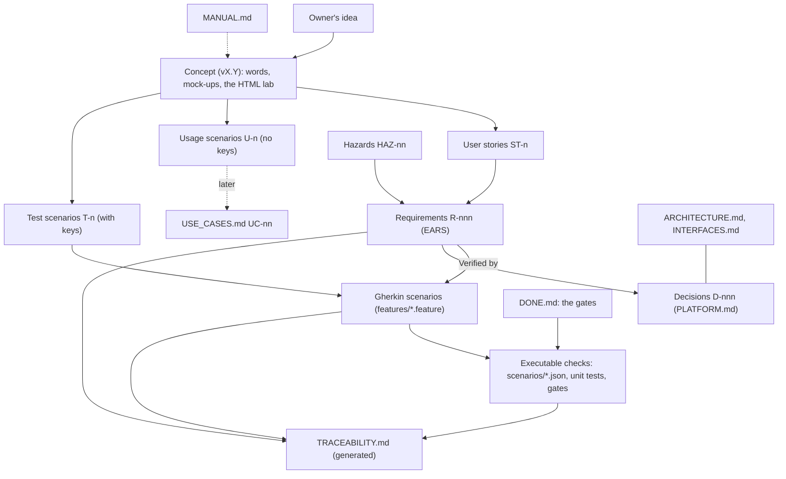
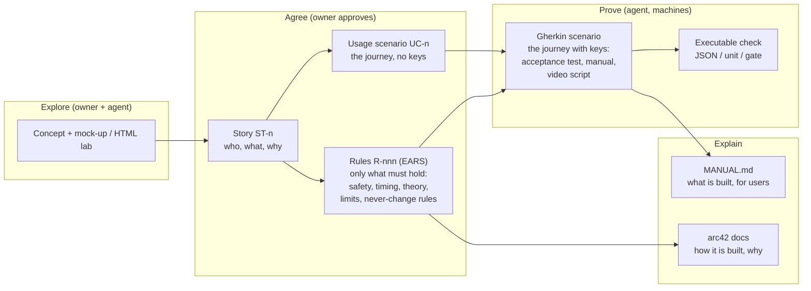
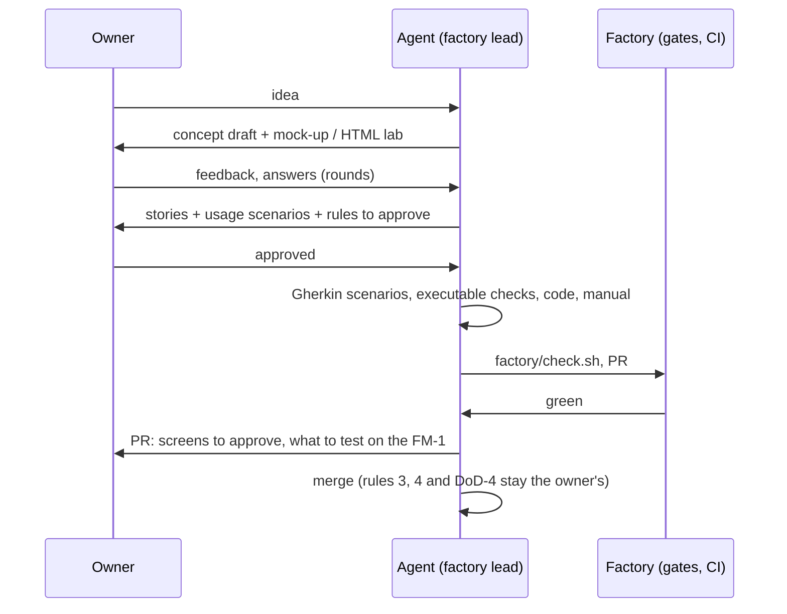
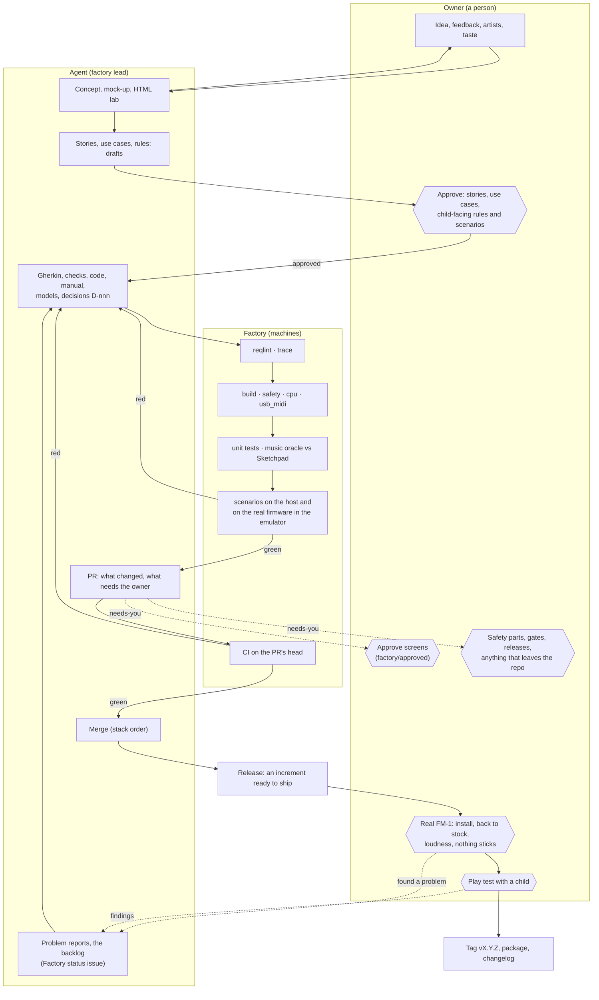

# Way of working

How an idea becomes firmware here: which documents exist, what each is for, how they link, and what is checked.
**Agreed with the owner on 2026-11-08**; `DONE.md` holds its checklists.

## 0. Decided (the owner, 2026-11-08)

1. **Requirements, mixed by what they say.** EARS (`When … the X shall …`) and Gherkin (`Given … When … Then …`) are
   close; we use each where it fits best. A **Gherkin scenario** states a behaviour a person does and sees, and once the
   owner approves it (tag `@approved:owner`, with its use case `@UC-nn`), it is the requirement: no EARS sentence
   repeats it. **EARS** states rules that must always hold: safety, timing, limits, theory equal to Sketchpad, and
   never-change rules. **Models** carry what neither says well: **states** (state diagrams of the modes and pages),
   **interactions** (sequence diagrams) and **interfaces** (INTERFACES.md), kept with the architecture.
2. **Concepts are exploratory**, not part of a release. The formal stories (`STORIES.md`), use cases (`USE_CASES.md`),
   requirements and scenarios are extracted from them when the owner agrees; the concept's step-by-step test scenarios
   are not maintained (the Gherkin scenarios are).
3. **arc42 as an index** over the existing files ([`arc42.md`](arc42.md)).
4. **A release is an increment ready to ship**: new features or fixes, merged, tagged, with the release checklist done.

## 1. What we do today

**What is sound.** The chain from requirement to scenario to executable check is closed by machines: `trace.py`
fails when a link breaks, `reqlint.py` keeps the wording clean, and the traceability matrix is generated, so it is
never stale. Decisions record the why. Mock-ups and the HTML lab let the owner try an experience before code exists.
That is the right core for a safety-minded product built by agents.

**Where it is heavy or duplicated.**

| # | Issue | Effect |
|---|---|---|
| 1 | The same journey is written three times: T-n in the concept, a Gherkin scenario, and the scenario JSON | Three places to keep in step |
| 2 | Every behaviour gets an EARS requirement *and* a Gherkin scenario, which say nearly the same thing ("NEXT sounds the next chord" vs "When F5 is pressed, then Dm9 sounds") | Double writing, and reqlint waivers when the owner's wording is natural rather than EARS |
| 3 | Usage scenarios (U-n) live in the concept; `USE_CASES.md` has one old UC-00 | Two homes for the same level |
| 4 | Concepts keep growing after they are built; what is true now is spread over the concept, `MANUAL.md` and the requirements | Hard to know where the truth is |
| 5 | Architecture is in four files (ARCHITECTURE, INTERFACES, PLATFORM's API table and decisions, HAZARDS) with no common outline | Fine today; will not scale |

## 2. Proposal: one chain, each level with one job

1. **Concept and mock-ups** explore; they are not the truth once something is built. A concept is frozen when its
   stories are agreed; the next idea starts a new version. New visual features always get a mock-up (static frames,
   or the HTML lab for anything you play) before code. **Once tried, the lab is the contract for the screen
   (D-084):** the firmware draws what the lab draws (layout, names, places, colours, messages). Before screens go to
   the owner for approval, the agent puts each next to the lab in the same state and fixes what differs; what the
   FM-1 cannot do the same way is listed in the PR.
2. **Stories (ST-n)** say who wants what and why. The owner approves them. They live in the Story issues on the board,
   with a copy in the concept.
3. **Usage scenarios** are the journeys without keys, and they move to `USE_CASES.md` as **UC-nn** when agreed (the
   stakeholder-level requirements). The concept's U-n become UC-nn; no second copy.
4. **Gherkin scenarios** are the journeys with keys and screens, the **acceptance tests**. They replace the concept's
   T-n (no third copy): the concept links to the feature file. They double as the manual's "try this" and as scripts
   for instructional videos. Each is `@auto` (an executable check runs it) or `@manual` (the owner on a real FM-1, or a
   play test).
5. **Requirements R-nnn in EARS** keep the rules that must hold and that a scenario alone states weakly: safety
   (volume, update path, flash), timing and limits (latency, CPU, voices), theory equal to Sketchpad, and
   never-change rules (the recording is kept as played, settings never change notes). **Behaviour that a Gherkin
   scenario states completely does not also need an EARS sentence**: the scenario, approved by the owner, is the
   requirement. Each scenario still traces to a story; each rule to a scenario or a gate.
6. **Executable checks** stay as they are (scenario JSON on both targets, unit tests, gates).
7. **The manual** says what is built, for users; it is updated in the same PR as the feature.
8. **Architecture in arc42 shape** (one outline for what we already have), and decisions D-nnn as its section 9.

## 3. arc42, mapped onto what exists

| arc42 section | Where it is (or goes) |
|---|---|
| 1 Introduction and goals | README (what the firmware is), concept v0.5 §1, DONE.md's quality goals |
| 2 Constraints | PLATFORM.md (the FM-1, felucca-bsp, licences), CLAUDE.md rules 1–9 |
| 3 Context and scope | ARCHITECTURE §1 (context) |
| 4 Solution strategy | ARCHITECTURE §2 (layers: fm1kit API, two backends, the factory) |
| 5 Building block view | ARCHITECTURE §2, INTERFACES IF-01–IF-09 |
| 6 Runtime view | ARCHITECTURE §3 (a key press, the modes) |
| 7 Deployment view | ARCHITECTURE §4–5 (flash, build, install) |
| 8 Crosscutting concepts | the screen design (D-037), theory from Sketchpad (rule 7), the song engine (D-031) |
| 9 Architecture decisions | PLATFORM.md D-001… |
| 10 Quality requirements | the EARS rules (R-nnn) for timing, CPU, safety; DONE.md metrics |
| 11 Risks and technical debt | HAZARDS.md, PLATFORM "Known gaps" |
| 12 Glossary | REQUIREMENTS.md glossary |

Recommendation: **keep the files, add the arc42 outline as a one-page index (`docs/arc42.md`)** that points to them;
move content only when a file gets too long. Cheap, and anyone who knows arc42 finds their way.

## 4. An increment, step by step

## 5. What DONE.md would hold (to agree)

**Every increment (a story's PR):**
- The story is approved; its usage scenario is in `USE_CASES.md`; new visual features had a mock-up the owner saw.
- Each `@auto` Gherkin scenario runs (scenario JSON, unit test or gate); rules R-nnn pass reqlint; trace is clean.
- `factory/check.sh` passes; CI is green.
- The manual describes what changed; decisions are recorded (D-nnn).
- The PR lists what needs the owner: screens to approve, tests on the FM-1, play tests.

**Every release (a firmware the owner installs):**
- Every screen approved; `@manual` scenarios done on a real FM-1; a play test where a child is the user.
- The update path tested both ways (install, back to stock); the version and the changelog written.
- Known gaps and hazards reviewed.

## 6. Answered

See section 0. The requirements already written in EARS stay; new behaviour from now on is written as approved Gherkin
where that says it completely.

## 6b. Agreed but not built yet (2026-11-13)

When a lab or a concept review agrees more than the next increment, its stories go to `STORIES.md` at once, their
requirements to `REQUIREMENTS-PLANNED.md` (the same EARS form, passing `reqlint`) and their Gherkin to
`features/planned.feature` (tagged `@planned` with the story and the use case). Nothing is lost between the review and
the build, and the owner reads it all in one place. When a story is built, its requirements move to `REQUIREMENTS.md`
and its scenarios to `fm1-scales.feature` with `@auto` and their executable checks: from then on the traceability
gate holds them. Decided by the agent (decide, then tell), on the owner's request "write all the stories, all
requirements, everything we discussed".

## 7. How the factory runs

Three parties: **the owner** (a person: what the product is and whether it is good), **the agent** (the factory lead:
designs, writes, decides what it may, merges) and **the factory** (machines: the gates on every change, CI on every PR).
GitHub holds the shared state: the board, the issues, the PRs.

### Who decides what (CLAUDE.md's tiers)

| Tier | Who | Examples |
|---|---|---|
| **Ask first** (the work waits) | the owner | what a child sees, hears or learns; learning content and styles; safety (update path, loader, flash, volume); breaking API changes, dependencies, licences; scope and priority; anything that leaves the repo (a release, an install, upstream); the gates themselves (thresholds, approvals, waivers) |
| **Low-level, from prior art** | the agent, then tells | flash layout, drivers, timing, formats: follows the most careful FM-1 firmware and cites it in a D-nnn |
| **Decide, then tell** | the agent | reversible technical choices within the approved spec (a D-nnn, listed in the PR) |
| **Just do it** | the agent | implementation, refactors that pass the gates unchanged, fixes that restore the spec |
| **Merge** | the agent | once `check.sh` and CI pass, in stack order; never a PR that touches the safety parts, approves screens, or changes what a child gets without the owner |

### What machines check, and what needs a person

| Checked by machines on every change | Needs the owner |
|---|---|
| Requirement wording, every link from story to check (reqlint, trace) | Whether the idea is right (concepts, stories) |
| The build fits flash and RAM; apps use only the API; the update path and the boot guard (build, safety) | That screens look right (approve references) |
| Every sound under the CPU budget with eight voices and four tracks (cpu) | Loudness in real ears, real keys' feel (a real FM-1) |
| MIDI in and out over the emulated USB cable (usb_midi) | That it installs on hardware and goes back to stock |
| Theory equal to Sketchpad, 14,823 answers (oracle) | Whether a child enjoys it and understands it (play test) |
| Every scenario on the host and on the real firmware in the emulator: sound, pitch, lights, timing, pixels (scenarios) | Safety parts, gates, releases |

### How we talk

| Channel | For |
|---|---|
| The conversation (this app) | ideas, questions with options and a recommendation, answers |
| Artifacts (pages like this one, the HTML labs) | mock-ups to play, documents to read |
| Issues: Story, Problem report, Decision, **Factory status** (the ordered backlog), label `needs-you` | the record of what was asked and decided, what waits for the owner |
| PRs ("Needs from the owner") and CI | what changed, what is verified, what the owner still has to do |
| Check-ins the agent schedules | merging when CI is green, picking work up again |

## 8. Is it a dark factory?

A dark factory runs with the lights off: no people on the floor. **This one is dim, not dark.**

- **Dark already:** from an approved story to a merged PR, no person is needed. The agent writes the scenarios, code,
  tests, manual and decisions; the factory checks every change on the real firmware in an emulator; the agent merges.
  Nights and weekends included.
- **Lit on purpose:** the owner decides *what* to build and whether it is *good*: the concept, the stories, the styles
  and taste, the screens, and anything a child gets. That is not a gap in the automation; it is the product's owner.
- **Lit because machines cannot reach it yet:** the real FM-1 (the emulator has no ROM update mode, no ears for
  loudness, no feel of the keys) and a child's reaction. These gates run at a release, not on every change.
- **What could dim it further:** a real FM-1 on a USB rig that the factory installs to and records (sound, lights,
  screen by camera) would move install, loudness and stuck-note checks to machines; the owner's taste written as rules
  (palette, type sizes, layout limits) would let a gate pre-check screens before the owner approves them.

The aim is not to remove the owner: it is that the owner spends their time only on what needs a person.
