# The fm1-scales experience — concept v0.1

> **Superseded by [v0.2](../v0.2/CONCEPT_v0.2.md)** (the owner's revision, 2026-11-06): one engine with three
> experiences (Producer, Guided, Game), any track as the starting point, key and tempo on GLO, ALGORITHM back to
> track selection. Kept for the history of the design; where they differ, v0.2 wins.

**Status: first draft (agent), discussed with the owner.** Once we agree on it, the factory writes the use cases
(`docs/USE_CASES.md`) and the requirements (`docs/REQUIREMENTS.md`) from it, story by story. Nothing here is built
yet except what is marked *built*. The screens are mock-ups (`make_mockups.py` in this folder draws them), not the firmware's
pixels.

## 0. What is already agreed

The owner's answers of 2026-11-06 (D-026):

| Question | Answer |
|---|---|
| Who is it for? | **Both**: children (a kids' view) and grown-ups learning (a teaching view) |
| How does the game wait? | **The animal waits at each fence** until the right key is played. Playing in time comes later, as a level |
| A wrong key in the game | **A soft "bonk"**: the right key blinks, and nothing is lost: no lives, no points taken away |
| Keys outside the scale | **They play softly** (an option in GLO: soft, silent or normal) |
| Chords | **Triads first** (C, Dm, Bdim); sevenths later |

## 1. The idea on one page

Three modes, picked with **ALGORITHM**, all built around one thing: **a song** (a key, a scale, a tempo and four
tracks: chords, bass, melody and drums).

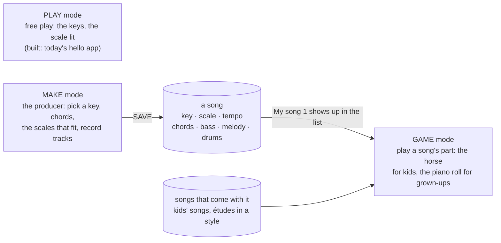

- **MAKE** helps you build: it shows the chords of the key, lights them on the keys, records them, then tells you
  which scales fit what you made and lights those notes while the loop plays.
- **GAME** uses the same songs as a game: the next note (or chord) lights up and you play it. Children get the horse
  jumping fences; grown-ups get a piano roll with speed and loop controls.
- A song made in MAKE can be played in GAME. The songs that ship with it are made the same way.

## 2. The controls

The same control does the same thing in every mode. The four knobs under the screen change with the page, and the
bottom line of the screen always says what they do.

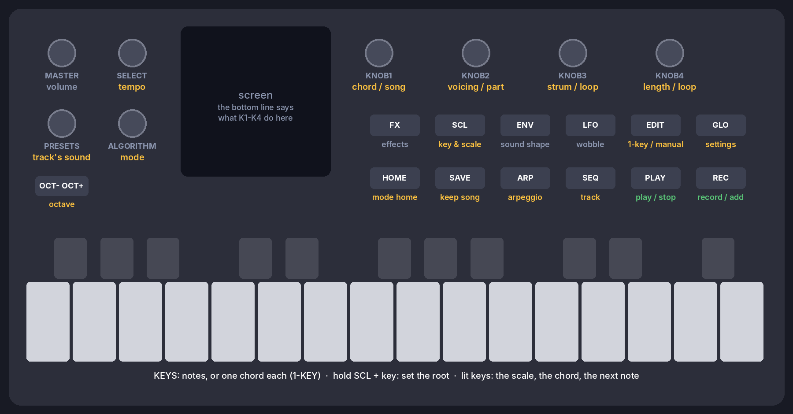

| Control | Does | Why this one |
|---|---|---|
| **ALGORITHM** | Picks the mode: PLAY, MAKE or GAME | The owner's choice. (Felucca uses it for its tracks; we put tracks on SEQ instead) |
| **SELECT** | Tempo | As in Felucca and fm1-chord |
| **PRESETS** | The sound of the track you are on | As in Felucca |
| **MASTER** | Volume (with the kit's ceiling) | The hardware's own |
| **SCL** | Key and scale page. **Hold SCL and press a key: that key becomes the root** | Its printed name; the hold is Felucca's and fm1-chord's gesture, and it teaches where the note is |
| **SEQ** | Next track: chords → bass → melody → drums; held: the four tracks at once | Its printed name |
| **EDIT** | How the keys play chords: **1-KEY** (one key plays a whole chord) or **MANUAL** (you play the lit notes) | "Edit how the keys behave" |
| **ARP** | Plays the chord as an arpeggio, at the tempo | Its printed name (uses the player built in #16) |
| **PLAY** | Play or stop the song | As everywhere |
| **REC** | Record. When stopped: add the chord on screen as the next bar | As in Felucca, plus step entry for children |
| **HOME** | Back to the mode's first page | Its printed name |
| **SAVE** | Keep the song in one of 8 slots | Its printed name |
| **GLO** | Settings: names (C D E / Do Re Mi), keys outside the scale (soft / silent / normal), view (kids / learn), the animal | "Global" |
| **OCT− / OCT+** | Move the keys an octave (two each way: built) | Their printed names. **Never both together**: holding both for 5 s is the way back to update mode, kept free on purpose |
| **FX, ENV, LFO** | Sound shaping, later | Not needed for learning; free for later |

**The lights on the keys** have four levels, and they mean the same thing everywhere:

| Level | Means |
|---|---|
| dim | in the scale: safe to play |
| breathing | the chord's notes, or the next note to play |
| full | the key you are holding |
| off | outside the scale (it plays softly) |

The keys can't show colours. The screen's piano repeats the lights in colour: blue for the scale, coral for the
chord, yellow for the key you hold.

## 3. MAKE: the producer

You go from a key, to chords, to the scales that fit, to a melody over your own loop.

| Step | You | The FM-1 | Screen |
|---|---|---|---|
| 1 | Turn ALGORITHM to MAKE. Hold SCL and press A (or turn KNOB1); KNOB2 picks the scale | Lights the scale on the keys, the root breathing | [Key](#31-the-key) |
| 2 | Turn KNOB1 through the key's chords: I ii iii IV V vi vii° | Lights the chord's keys and sounds it. It names it (Am), its degree (vi) and its notes (A C E) | [Chords](#32-chords-you-play-yourself-manual) |
| 3 | Play the lit keys | A tick when you hold the right three; the chord sounds | |
| 4 | Press REC | The chord joins the progression as the next bar (up to 8 bars) | |
| 4b | Or: EDIT to 1-KEY, then PLAY + REC | Every key in the scale plays its own chord; what you play is recorded on the beat | [1-KEY](#33-one-key-one-chord-1-key) |
| 5 | Press SCL | **The scales that fit your chords**, best first, with why | [Fits](#34-the-scales-that-fit) |
| 6 | Pick one, SEQ to MELODY, PLAY | The loop plays; the scale is lit, and the notes of the chord playing now breathe | [Melody](#35-a-melody-over-your-loop) |
| 7 | REC and play | Your melody is recorded on its own track, with its own sound (PRESETS) | |
| 8 | SEQ to BASS, the same | The roots of the chords breathe: the notes a bassline starts from | |
| 9 | SAVE | The song is kept, and shows up in GAME as "My song 1" | [Tracks](#36-the-four-tracks) |

### 3.1 The key

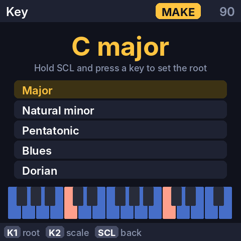

The scale list grows with the lessons; the first ones are Sketchpad's ten scales (built: `KIT_SCALES`).

### 3.2 Chords you play yourself (MANUAL)

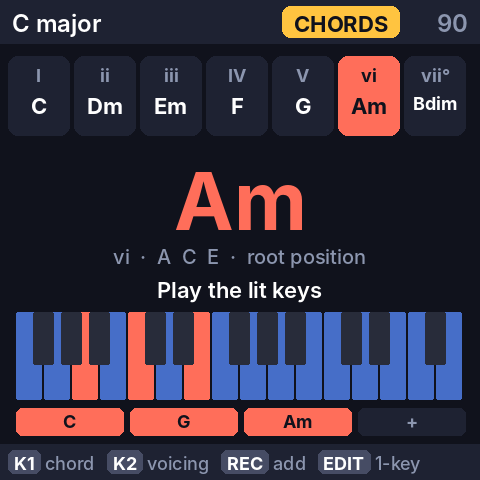

- KNOB1 moves through the seven chords; the screen shows all seven, so you see the whole key at once.
- KNOB2: the voicing: root position, first inversion, second inversion (the lit keys move).
- The keys of the chord **breathe** on the FM-1 and are coral on screen; the rest of the scale is dim.
- REC adds the chord as the next bar. The strip at the bottom is the progression so far.
- Composing is choosing: turn, listen, add what you like.

### 3.3 One key, one chord (1-KEY)

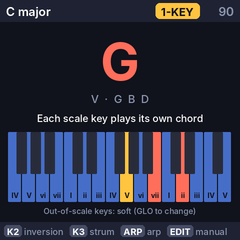

- EDIT switches to 1-KEY. **Each key in the scale plays the chord built on it**: in C major, C plays C, D plays Dm,
  and so on. A child learns that every note of the scale has its own chord, and where it is.
- KNOB2: inversion. KNOB3: strum (0 = all at once, up to a slow strum). ARP: the chord as an arpeggio at the tempo.
- Keys outside the scale play softly (GLO changes it).
- Prior art: fm1-chord puts the seven chords on the seven leftmost white keys, whatever the key. We tie each chord
  to its own root instead: it teaches more, and the lights show it.

### 3.4 The scales that fit

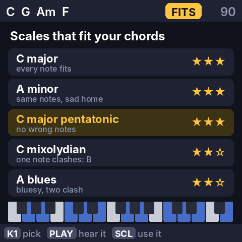

Ranked by the notes you actually used, as Sketchpad's "which scales fit" does (its `harmony` module, already planned
for porting: D-024). Each one says why in a few words. PLAY lets you hear it over your loop before you choose.

### 3.5 A melody over your loop

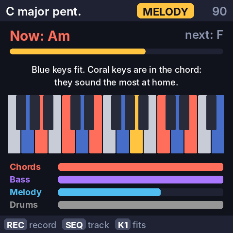

While the loop plays, the lights follow it: the scale stays dim, and **the notes of the chord playing now breathe**,
because they are the ones that sound most at home. The screen says the chord now and the next one, so you can
get ready.

### 3.6 The four tracks

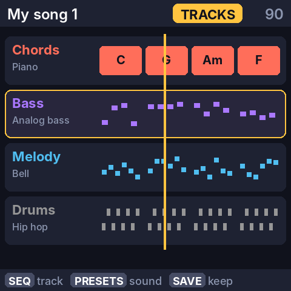

Each track has its own sound (PRESETS on that track). Drums are picked from ready patterns per style (hip hop,
funk, pop, ...) rather than played, at first.

### 3.7 Later: the phrase finisher

Record a bar or two in a scale and press a button: the FM-1 offers three ways to finish the phrase, in a style you
pick (pop, hip hop, trap, g-funk). KNOB1 picks one, PLAY plays it, REC keeps it. It would be rule-based, from
Sketchpad's `melody`, `figures` and `styles` modules, not a neural network: a generator like fm1-x0x's TB-3PO
line generator or Clipper's melody generators. **Later, after GAME.**

## 4. GAME: learn a song by playing it

| Step | You | The FM-1 |
|---|---|---|
| 1 | Turn ALGORITHM to GAME | The song list: the kids' songs, the études, and your own |
| 2 | KNOB1: a song. KNOB2: the part: melody, bass or chords | The song's key and scale light dimly |
| 3 | PLAY | The other parts play along (the backing); your part is the game |
| 4 | Play the lit key | The animal jumps; your note sounds |
| 5 | Finish | Stars: how few hints you needed. Never zero for finishing |

### 4.1 The songs

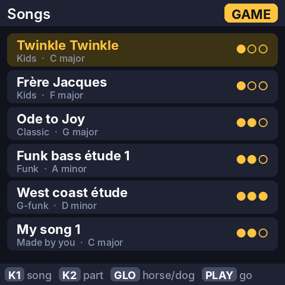

### 4.2 The kids' view: the horse

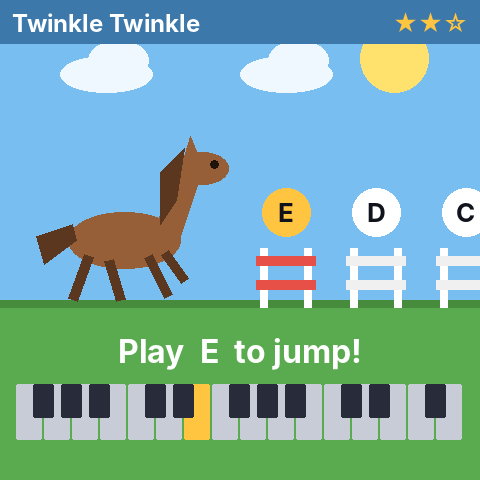

- A horse (or a dog: GLO, or more animals later) runs to the right. **Each fence is a note of the song**, with its
  name on it (C D E or Do Re Mi).
- The next key **breathes**. Play it and the horse jumps it and the note sounds.
- **The horse waits** at a fence until the right key comes; the backing waits too. Wrong key: a soft bonk, the
  right key blinks, nothing is lost.
- **Chords:** a wide fence with three names; the three keys breathe; the horse jumps when all three are held.
- No full-screen flashing (HAZ-03): the horse moves, the sky stays still.
- The horse and the dog are our own drawings.

### 4.3 The grown-ups' view: learn the part

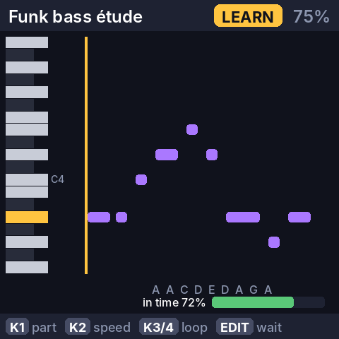

- A piano roll: the notes come from the right to the line; the keyboard down the left lights the next note, and so
  do the FM-1's keys.
- KNOB1: the part (bass, melody, chords). KNOB2: the speed (25 % to 100 %). KNOB3 and KNOB4: the bars to loop, to
  practise a hard bit.
- EDIT: **wait** (stops at each note until you play it) or **in time** (keeps going; it says how much you played in
  time).
- This is where a Chromeo-style bassline is learned: slow it to 50 %, loop the two hard bars, play along until it
  sits, then speed it up.

### 4.4 Where the songs come from

**This needs the owner (question 4 below).** Real songs' melodies and basslines are copyrighted, and this firmware
is meant to be public (GPL). What it can ship:

| Kind | Examples | Can ship? |
|---|---|---|
| **Public-domain songs** | Twinkle Twinkle, Frère Jacques, Ode to Joy, Happy Birthday (free since 2016), folk songs | Yes |
| **Our own études in a style** | A funk bassline in the style of Chromeo, a West-coast g-funk groove (the whiny portamento lead, the slow swing), a disco octave bass | Yes: a style is not owned, a song is |
| **Your own songs** | Made in MAKE, or sent from a computer as MIDI | Yes, kept on your FM-1, never shipped |

So the library would be public-domain songs plus études we write to teach each style's moves. Your favourite real
songs come in through MAKE or MIDI, on your FM-1 only.

## 5. What the platform needs for this

| Need | Today | Work |
|---|---|---|
| Four tracks, each with its own sound, at once | One sound at a time | API change (multi-timbral) and the CPU gate (heaviest sound: 56 % for 8 voices alone) |
| Drums | None | Drum sounds and patterns: prior art in fm1-chord (56 drum loops) and fm1-x0x |
| A four-track sequencer with bars | The player plays one list of notes (built: #16) | The player grows into tracks and bars |
| Keeping 8 songs | The store keeps one record of 1 KB | A bigger store region: a low-level decision from prior art (Felucca's projects, SLOOP) |
| Chords, voicings, the scales that fit | Scales and run orders (built) | Port Sketchpad's `chords`, `harmony` and `voicing` (D-024), checked by the oracle |
| The horse | Shapes and text | Sprites with frames, drawn without full-screen flashes |

## 6. A proposed order

1. **The MAKE chords page (MANUAL), with REC step entry.** The heart of the learning, and the chord port it needs.
2. **1-KEY** chords and ARP.
3. **GAME, the kids' view, melody only**, waiting mode, with three public-domain songs. The fun one.
4. **The scales that fit**, and a melody track over the loop.
5. **Four tracks with their own sounds** (the platform work above), bass and drums.
6. **GAME, the learning view**, speed and loop, the first études.
7. **GAME with chords**, then playing in time.
8. **The phrase finisher.**

## 7. Questions for the owner

1. **Mode on ALGORITHM, tracks on SEQ.** Felucca puts tracks on ALGORITHM, so this differs from what FM-1 owners
   know. Recommended as written; the alternative is modes in a HOME menu.
2. **The root by holding SCL and pressing a key**, plus KNOB1 on the key page. Recommended: it teaches where the
   note is.
3. **Recording:** step entry (REC adds a bar) for children *and* live recording on the beat for grown-ups, 8 bars
   at most at first? Recommended.
4. **The songs:** public-domain songs, our own études in a style, and your own through MAKE or MIDI (section 4.4).
   And what did you mean by "Dolly styles": Dolly Parton songs, or a kind of children's song?
5. **Kids' view or learning view:** a GLO setting, or chosen by each song? Recommended: GLO, so a child always
   gets the horse.
6. **Animals:** a horse and a dog, or a few more for the child to choose from (cat, unicorn, ...)?
7. **The order in section 6:** MAKE chords first, or the horse game first (more fun sooner, less theory)?
