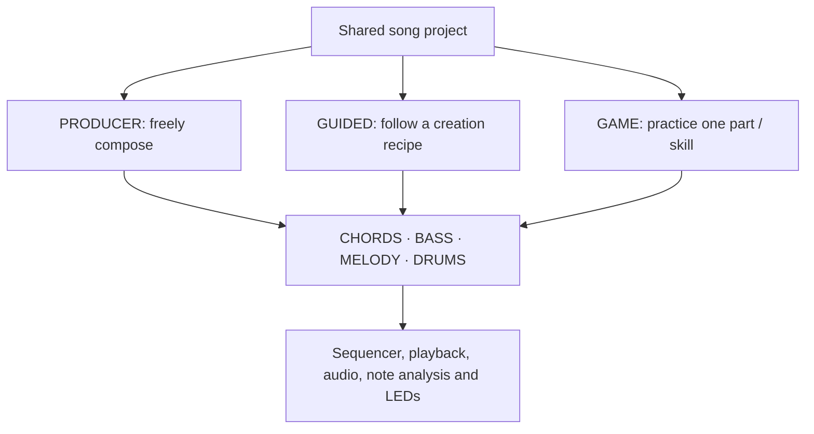
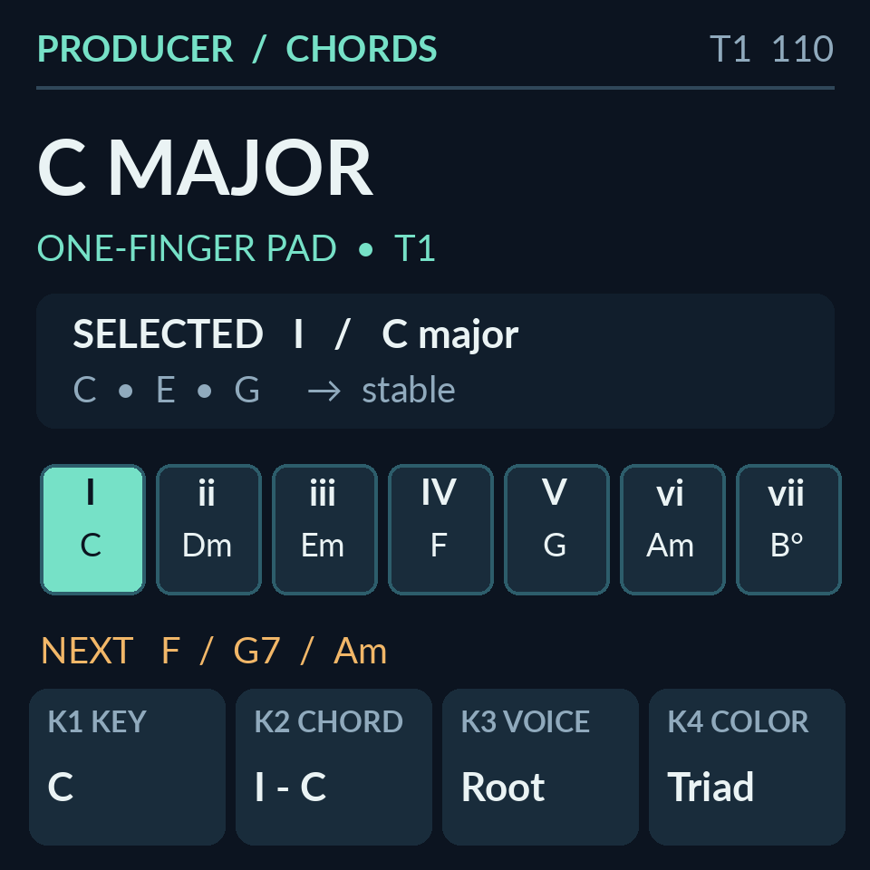
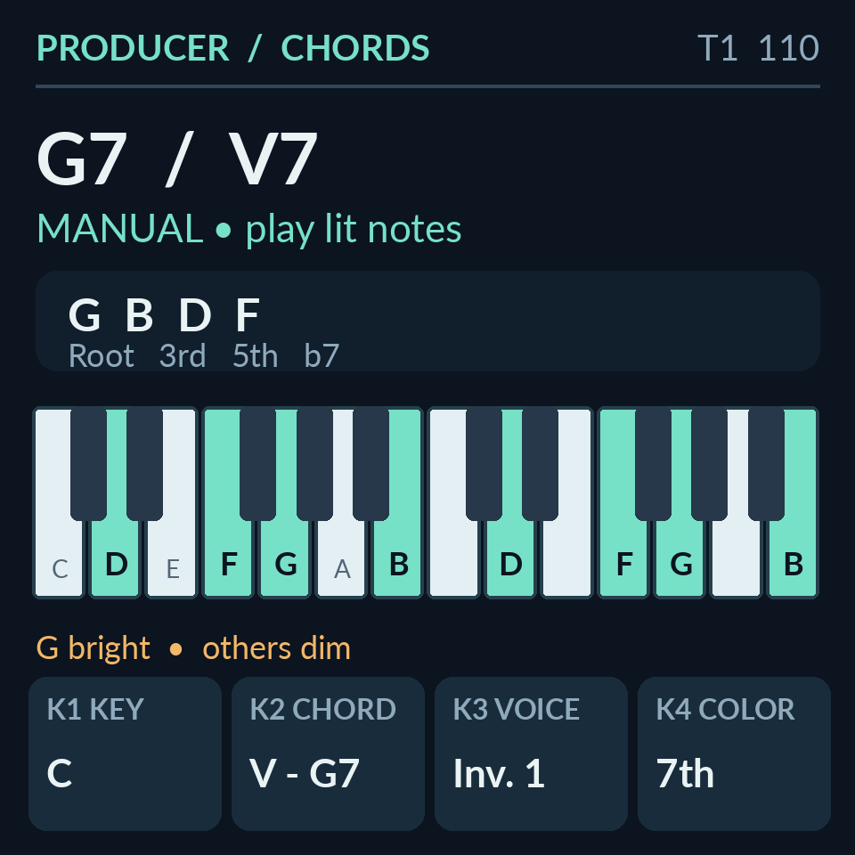
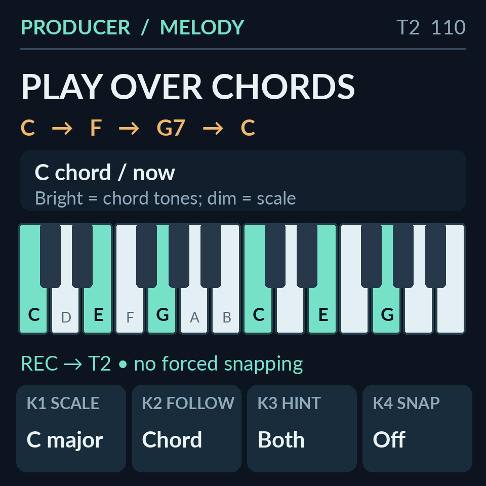
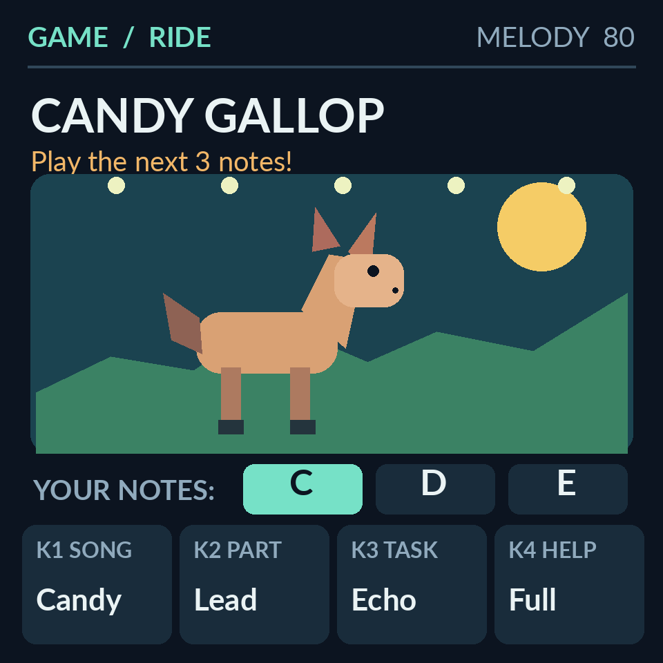
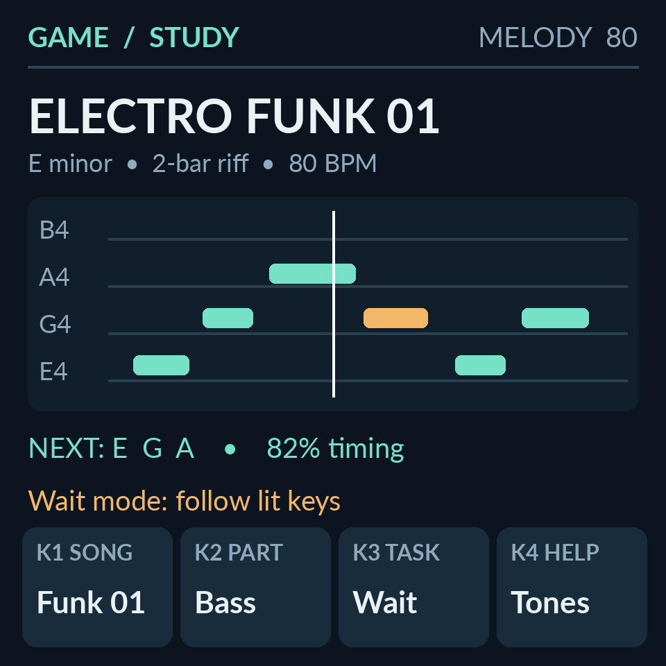

# FM-1 Music Companion — Interaction Concept v0.2

**Status:** concept for review, *not* firmware requirements.  
**Date:** 6 November 2026  
**Platform:** standalone M-VAVE FM-1; reuse Felucca's four-track audio, sequencer and keyboard capabilities where possible.  
**Core idea:** One music engine, three experiences: **PRODUCER** (create), **GUIDED** (learn by creating), and **GAME** (practice short musical challenges). The song is the shared source of truth.

> **What changed since v0.1:** Key and tempo are on **GLO/Global**, not permanent creative knobs. **Any track can be the starting point.** Auto key analysis makes *suggestions*, never silently modifies playback or remaps the keys. **Guided** is now a first-class third experience. **Game** is a focused slice of Guided, with child/adult screen themes rather than separate musical engines.

## 1. The three experiences



| Experience | Starting point | Controls | Result |
| --- | --- | --- | --- |
| **Producer** | Chords, bass, melody **or** drums | Free track selection and contextual musical tools | An original, editable four-track song |
| **Guided** | A selected tutorial: e.g. electro-funk bass, pop harmony, G-funk groove | Guided steps with demonstrations and explanations; ability to deviate | A song the player created while learning the style |
| **Game** | A prebuilt song or a phrase from the player's own project | Watch / Echo / Play Along / Note Find / Chord Build | A short practice take and feedback, without changing the source |

The **same song engine** provides key and harmony analysis, arrangement, playback, track mutes, note events, LED hints and audio. Modes only change *who chooses the next action and how information is presented*. A Guided-created project can be opened in Producer. A Producer-created phrase can be used as a Game exercise.

## 2. Shared four-track song

| Track | Data | Typical instrument | Used for practice? |
| --- | --- | --- | --- |
| **1 CHORDS** | Chord identities **and** exact played note events / inversions | Polyphonic keys/pad | One-finger chord or manual chord practice |
| **2 BASS** | Notes, rhythm, articulation | Mono synth bass | Pitch, timing, groove, octaves |
| **3 MELODY** | Notes, rests, rhythm | Lead or pluck | Melody memory, intervals, scales |
| **4 DRUMS** | Drum-lane events | Drum kit | Rhythm, beats, subdivisions |

These are *proposed* fixed roles for Music Companion, not Felucca's original track names. Each track has its own sequence and sound; all four share the same transport and harmonic timeline. A four-bar loop is a good default but not a limit. Keep within Felucca's existing voice/polyphony constraints when choosing voicings and arrangements.

**The recorded performance is authoritative.** Analysis must never destroy a note that sounds 'out of scale.' Harmony and chord names are overlays, not replacements for recorded notes.

## 3. Physical controls — consistent proposed map

Existing Felucca controls are a useful starting point: **ALGORITHM** normally selects T1–T4, **PRESETS** picks a sound, **SELECT** normally adjusts BPM, **SCL** has a scale/chord page, **REC** arms recording and **PLAY** starts transport. We keep the recognizable meanings where practical and move tempo to GLO for our workflow.

| Control | Outside menus | Inside contextual pages |
| --- | --- | --- |
| **MASTER** | Master volume | Always volume |
| **ALGORITHM** | Select active part: CHORDS / BASS / MELODY / DRUMS | In the mode picker only, selects PRODUCER / GUIDED / GAME |
| **PRESETS** | Select active track sound | List navigation only where explicitly labeled |
| **SELECT** | Browse the *current suggestion or option* (without recording/changing notes) | List selector / currently highlighted candidate |
| **KNOB 1–4** | The four fields named at the bottom of the current screen | Contextual; full assignments below |
| **GLO** | Open shared Project/Global settings | K1 key, K2 BPM, K3 meter, K4 loop bars |
| **HOME tap** | Song overview; tap again to return to current part | — |
| **HOME hold** | Open main experience picker (PRODUCER / GUIDED / GAME) | OCT+ accept, OCT− back |
| **SCL tap** | CHORDS: switch **PAD ↔ MANUAL**; BASS/MELODY: toggle harmony guide | In GAME, show/hide hint overlay |
| **PLAY** | Start/stop song | Preview/replay in lessons |
| **REC** | Arm selected track, live record with PLAY, or step-input when stopped | In GAME, record a scratch attempt, never overwrite song |
| **SEQ** | Open note/step editor for selected track | Edit durations, steps, quantize, undo |
| **SAVE** | Save project / Save As when library content is locked | Hold for undo |
| **OCT− / OCT+** | Change playing register | In dialogs/lesson steps: back / accept |

**No encoder press is assumed.** The physical controls only need turning, tapping and holding buttons. The exact hold/tap conflicts with Felucca can be settled when defining implementation requirements; these are intentional proposed remappings.

### GLO: song-wide settings

```
┌────────────────────────────┐
│ GLO / SONG SETTINGS        │
│                            │
│  KEY         TEMPO         │
│  AUTO        108 BPM       │
│                            │
│  TIME        LOOP          │
│  4/4         4 BARS        │
│                            │
│ K1 KEY  K2 BPM  K3 MTR     │
│ K4 BARS                    │
└────────────────────────────┘
```

- **KEY = AUTO:** analyze material, show candidate keys/scales, but do not force a decision or change the pitch of recorded notes.
- **KEY = LOCKED (e.g. C minor):** use the chosen harmony as the default recommendation palette. Out-of-key notes still play in Producer.
- **Tempo:** one project tempo; Game has a separate *temporary* practice-speed percentage.
- **Changing locked key:** offer `REINTERPRET ONLY` vs `TRANSPOSE SONG` where relevant. Never silently transpose the sequence.
- **No notes recorded yet:** AUTO stays unknown. Chord pads can use an explicitly chosen **temporary chord palette** (initial suggestion C major) until the player accepts a key. Once the pad mapping is in use it must not shift beneath the user's fingers.

## 4. Producer — complete free workflow

### 4.1 Choose any starting part

Start a project and rotate **ALGORITHM** directly to CHORDS, BASS, MELODY or DRUMS. No wizard and no prescribed starting order. GLO can remain on KEY=AUTO throughout.

**First step: bass example**
1. ALGORITHM → **BASS**. PRESETS → choose a bass sound. The physical keyboard is chromatic; OCT− shifts into useful range.
2. Tap **REC**, then **PLAY** (optionally a count-in) and record a riff into T2. The exact notes and timing remain recorded.
3. Stop. Screen offers `ANALYZE: 3 POSSIBLE PALETTES`, not `YOU ARE IN C MAJOR`.
4. Turn SELECT to browse candidate scale/key contexts; as you browse, the display shows matching notes and **previews** which chord suggestions might follow. **OCT+** accepts the current guide palette if desired; this does *not* rewrite notes.
5. ALGORITHM → **CHORDS**. In PAD view, choose/confirm a provisional tonic if AUTO is inconclusive. Try harmonies over the looping bass, then REC a chord progression.
6. ALGORITHM → **MELODY**. The LEDs now display *current chord tones* strongly and other selected scale tones softly. Record a melody over the two existing tracks.
7. Add drums at any point, using the existing drum grid or live input.

**Why not auto-change scale after every note?** A short phrase is ambiguous: C–F–B♯ sounds as C–F–C in twelve-tone equal temperament, so there is insufficient evidence to identify a unique key. Even with a longer riff, chromatic passing notes and borrowed chords may be deliberate. Show ranked, explainable possibilities; accept only explicit commitments.

### 4.2 Chords: PAD vs MANUAL

These two views are *input styles for the same CHORDS track*, not separate tracks.

**PAD = choose complete chords quickly**
- The **left seven white keys** are degree pads `I / ii / iii / IV / V / vi / vii°` in the active/provisional palette, independently of physical note labels. The next seven white keys may repeat degrees in another register; exact secondary-pad layout can be tested later.
- Pressing one pad sounds a chord; its **actual voiced notes** are recorded when REC is active.
- **SELECT** browses a highlighted chord/candidate without sounding or recording it. A real key press auditions it.
- Right knobs: **K1 PALETTE** (`DIATONIC`, `BORROWED`, `CHROMATIC`), **K2 COLOR** (`TRIAD`, `7TH`, `SUS`, `ADD9`...), **K3 VOICE** (`ROOT`, `INV1`, `INV2`, `OPEN`...), **K4 FEEL** (`BLOCK`, `STRUM`, `ARP`).
- Screen: chord name, Roman numeral, the exact notes in the voicing, current bar and four knob labels. The currently highlighted degree is brightest on the key LEDs.
- PAD need not be constrained to the 7 chords of a major key forever: borrowed and non-diatonic chords become available via K1 and browsing, without adding a confusing default button layout.

**MANUAL = explore notes and play actual chords**
- The keyboard remains a **normal chromatic keyboard**. No mandatory snap-to-scale.
- **SELECT** cycles suggested target chords such as `C`, `Fmaj7`, `G7`, `Am`; physical keys belonging to the selected chord illuminate. The screen shows piano notes and chord role labels (root, third, fifth, seventh). The user can try **any inversion** or an unexpected chromatic note.
- K1–K3 retain **PALETTE / COLOR / VOICE**; K4 becomes **GUIDE** (`ALL TONES`, `ROOT`, `OFF`) because the notes are played by hand rather than strummed automatically.
- The chord label under the actual notes played is a *best-effort analysis*, not a hard restriction.
- REC saves what was *actually* played, even if it differs from the highlighted target.





### 4.3 Harmony-aware bass and melody tools

| Part | K1 | K2 | K3 | K4 |
| --- | --- | --- | --- | --- |
| **BASS** | PALETTE: AUTO / selected scale | TARGET: root / fifth / passing / all | GROOVE: free / eighths / syncopation | GUIDE: LEDs off / suggested / strong |
| **MELODY** | PALETTE: AUTO / major / minor / pentatonic / blues | FOLLOW: song key / current chord | GUIDE: off / chord tones / scale / both | SNAP: off / optional on |
| **DRUMS** | KIT | LANE: kick / snare / hat / other | DENSITY / recipe | SWING |

**AUTO** means suggestions are recalculated from recorded musical context — not that previously recorded notes get mutated. In BASS or MELODY, harmonically appropriate lights are suggestions, not an absolute truth. Blues, funk and G-funk often depend on expressive out-of-scale notes.

**REC rule:** Stopped + REC + chord pad can write one chord per bar (easy sketch); REC + PLAY starts real-time loop recording. Stop/playback and active-track indicators are prominent, to avoid recording into the wrong part. SEQ handles detailed edits and chord durations, including multiple chords per bar.

### 4.4 Producer example, from chords

1. GLO: `KEY C MAJOR`, `BPM 105`, `4 BARS`.
2. ALGORITHM → CHORDS; SCL → PAD. Play `I → V → vi → IV` to audition `C → G → Am → F`.
3. K2 turns `G` into `G7`; K3 tests a first inversion. Use REC to record preferred chords; PLAY loops the harmony.
4. ALGORITHM → BASS; LEDs emphasize chord roots/fifths; record a groove, preserving syncopation.
5. ALGORITHM → DRUMS; create four-on-the-floor or syncopated kick/snare groove.
6. ALGORITHM → MELODY; select `FOLLOW CURRENT CHORD`, see recommended notes update with each bar, record a melody.
7. HOME gives the 4-track song overview; SAVE persists your song. Open it in Game to practice the bass or chord part.



## 5. Guided — learn a style by creating a song

**Guided is Producer with a teaching layer**, not another sequencer. Each tutorial is a small 'recipe' with a goal, an example arrangement, prompts, demos, an optional starting pattern and musical explanations. You can **Skip**, **Repeat**, **Hear Example**, **Show Why** or **Open in Producer**. No hard lock preventing creative experimentation.

### Example A: 'Make an electro-funk bass groove' (12–20 minutes)
1. **Hear:** play an original, short electro-funk example. Screen: `TODAY: Syncopation + Octaves`.
2. **Set up:** song defaults to `A MINOR`, `112 BPM`, 4 bars in GLO. Accept or change.
3. **Bass first:** it demonstrates a two-bar riff with rests and octave jumps. You imitate it with illuminated hints or record your own variation.
4. **Drums:** add a kick/snare/hat pattern; learn where bass syncopation fits against the backbeat.
5. **Chords:** choose Am7 and D9 or different harmonically fitting colors; explanation focuses on how sevenths and ninths change the feel.
6. **Melody:** choose an A-minor pentatonic starting palette, play over your backing, and discover where chord tones matter.
7. **Arrange:** record a variation for the next section. The user-created performance becomes a normal four-track project.
8. **Practice:** optional jump directly to Game for a bass-timing challenge on the riff you just built.

### Example B: 'Make a bright bubblegum-pop chorus'
1. **Chords first**: I–V–vi–IV (or simpler I–IV–V) on chord pads.
2. **Rhythm**: a bouncy pop beat; clap and note subdivisions.
3. **Melody**: start with three notes, repeat a hook, then make an ending different.
4. **Bass**: roots and octaves under the progression.
5. **Song**: a short chorus you can play together with a child.

### Guided navigation proposal

| Action | Effect |
| --- | --- |
| **OCT+** on tutorial screen | Accept step / Next |
| **OCT−** | Previous / Back |
| **PLAY** | Hear demonstration or play current project, as labeled |
| **REC** | Record current requested part, into the same four-track project |
| **SCL** | Show/hide illuminated help |
| **HOME** | Song overview; keep tutorial state |
| **HOME hold** | Experience picker → Producer / Guided / Game |

On the 240×240 display, each teaching screen presents **one instruction and one action**, plus the track/instrument and four contextual knob labels; avoid multi-paragraph lessons on hardware.

## 6. Game — one enjoyable slice of Guided

**Game chooses a song, a part, and a challenge; it does not run a separate music engine.** The accompaniment plays the other three tracks while the player practices the target one. If playing BASS, the recorded bass can be muted, played quietly as a guide, or played as an echo example.

### Recommended Game workflow
1. **SONG:** choose `Original Pop #1`, `Funk Bass #2`, or `MY SONG`.
2. **PART:** chord pads, manual chords, bass, melody or drums.
3. **TASK:** `WATCH`, `ECHO`, `NOTE FIND`, `BUILD CHORD`, `PLAY ALONG`, later `FINISH PHRASE`.
4. **HELP:** illuminate all notes / chord tones / root only / none.
5. **SPEED:** practice-speed percentage, e.g. 60%, independent of the project BPM.
6. **PLAY:** other tracks accompany; pitch and timing are assessed separately. REC optionally saves a **scratch take only**.

| K1 | K2 | K3 | K4 | SELECT |
| --- | --- | --- | --- | --- |
| SONG | PART | TASK | HELP | SPEED % |

### One game engine, two presentations

- **Kids:** a horse trots to the rhythm or jumps over obstacles as phrase milestones are reached. Allow partial success; make the feedback encouraging and musical, not punishing. Simple large notes/keys and playful original pop songs.
- **Study/adult:** a compact piano roll or note names, current chord and scale degrees, timing delta (early/late), repeating a difficult bar, progression of hint removal. Funk bass and G-funk are great styles for timing and note-choice exercises.
- **Presentation ≠ difficulty:** either player can choose any song and lesson level. Use a profile/display setting, not separate note content.





**Song packs:** include original examples in broad styles: playful bubblegum pop, electro-funk, West Coast synth-funk, boom-bap, trap and simple public-domain material. Contemporary artists can guide *broad musical characteristics* but should not result in distributing unlicensed song arrangements or copying recordings.

## 7. Later: Phrase Finalizer

In Producer, record half a phrase on the melody or bass track, select it in SEQ, and choose **FINISH**. A small standalone algorithm offers three candidates: `RESOLVE`, `LIFT`, `TWIST`. Use SELECT to audition, OCT+ to insert a selected candidate, OCT− to cancel; generate within recorded harmony but allow stylistic outside notes. K1 similarity, K2 cadence goal, K3 density, K4 style (`FUNK`, `HIP-HOP`, `G-FUNK`, `POP`). This stays outside the first release; no LLM is required at runtime.

## 8. Version-one interaction acceptance scenarios (NOT formal requirements)

1. **Start with chords**: within 30 seconds of boot, get a chord-pad progression playing and record it without entering a step-grid editor.
2. **Start with bass**: record C–F–C in AUTO and see multiple plausible scales with uncertainty instead of a falsely definitive key change.
3. **Chord styles**: switch PAD ↔ MANUAL, audition G7, see its notes illuminated, record a custom inversion without forced quantization.
4. **Adapt hints**: after T1 harmony is recorded, melody LEDs follow currently sounding chord tones without altering the melody already recorded.
5. **Guided project**: follow an electro-funk tutorial, skip one step, finish the song, and open it unchanged in Producer.
6. **Game**: load the same song, mute its bass track, play along with drums/chords/melody at 65% speed, see kid or adult rendering, and leave the source song unchanged.
7. **Offline and safe**: no connection required, audio never blocks on analysis, clear save/undo, no unexpected auto-transpose or auto-remap.

## 9. Questions to settle before specifications

- Should the **ALGORITHM** knob remain purely track selection, including when SONG overview is open? (Recommended yes.)
- How exactly should a **provisional chord-pad key** be selected when GLO is AUTO with no strong inference? (Recommended SELECT chooses, OCT+ locks *pad palette* without forcing global key.)
- In PAD, do the right seven white keys duplicate diatonic degrees at a higher register or offer a separate chord bank? (Recommended repeat first; test physically.)
- Should changes to a selected chord's voicing/color affect *only the next new recording* or also update a held chord? (Recommended live audition, never rewrite old events.)
- How should timing work in 1-chord-per-bar quick entry before adding half-bar changes? (Recommended quick entry first, explicit SEQ durations later.)

## Source notes

This document is a proposed Music Companion mapping, not a description of Felucca as shipped. References:

- Felucca controls and beginner documentation: https://fuleo.github.io/fm1-guide/felucca.html
- Felucca chord/key entry and voicings: https://fuleo.github.io/fm1-guide/felucca-advanced.html
- Felucca installer and panel reference: https://chancethemaker.github.io/Felucca/webapp/installer/
- Example existing FM-1 chord machine (useful as a comparison, not a dependency): https://github.com/math0ne/fm1-chord

**Visual note:** the embedded images are prior conceptual v0.1 mockups reused to illustrate layouts, not final v0.2 knob labels or running firmware screenshots. The FM-1 has single-color brightness-controlled key LEDs rather than color-variable key lights.
