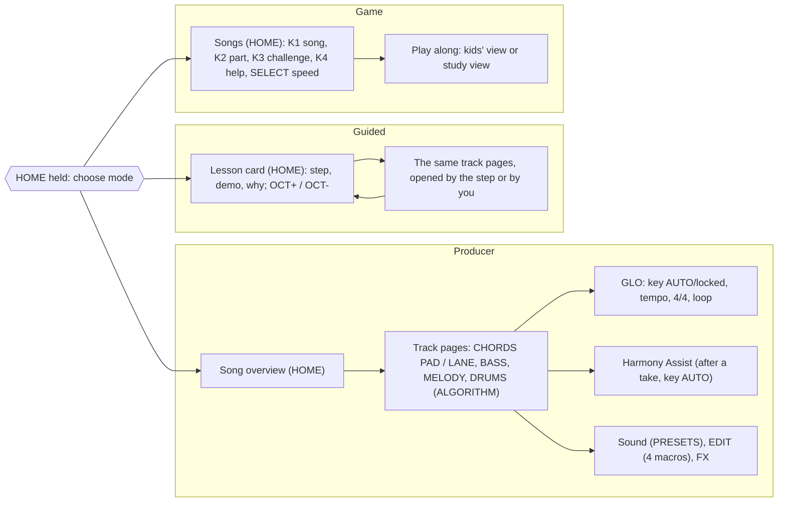

# Concept v0.4 — branching map (draft for the owner)

**Status:** a draft by the agent, from the owner's v0.3 workflow and feedback of 2026-11-07, to correct while the cases
are thought through. Not requirements. The playable model is `simulator.html` here (also published as a private page).

**The axis:** what the FM-1 offers on each page depends on the **mode** and on **what the song already has**. A page never
changes what was recorded; it only changes what it lights, suggests and offers.

## 1. Modes and their screens

Hold **HOME**: the mode picker. Tap **HOME**: the mode's own home. The header badge (and one flash of the keys when you
switch) says which mode: **Producer** amber, **Guided** teal, **Game** purple. The song stays as it is when you switch.

| Screen | Producer | Guided | Game |
|---|---|---|---|
| Song overview | home | from the lesson card | — |
| Track pages (chords, bass, melody, drums) | all | all; the step opens the one it needs | — (the part is picked on K2) |
| GLO | yes | yes (the lesson proposes values) | — (speed is SELECT, a practice setting) |
| Harmony Assist | yes | yes, explained | — |
| Sound (PRESETS), EDIT, FX | yes | yes | sound only |
| Lesson card | — | home | — |
| Song list, challenge, help | — | — | home |
| REC | records the track | records the track | a practice take only, the song untouched |

## 2. What the song has → what each page offers (Producer; Guided adds the lesson's words)

| The song has | CHORDS (PAD / LANE) | BASS | MELODY | DRUMS |
|---|---|---|---|---|
| **Nothing** | Pads in GLO's key (C major on AUTO). "Empty song: start anywhere." | Free; AUTO listens | Free; AUTO listens | The kit |
| **Bass only** | If AUTO and no palette yet: Harmony Assist first (ambiguous or clear); then pads in the chosen palette, "over your bassline" | Lit: the palette | Lit: the palette | The kit |
| **Melody only** | As with bass only (the melody's notes are analysed) | Lit: the palette | Lit: the palette | The kit |
| **Chords** | PAD: as before; LANE: the progression as bars, now bright, next breathing | Breathing: root and 5th of the chord now; dim: the palette | Breathing: the chord now; dim: the palette | The kit |
| **Chords + bass** | As chords | As chords | As chords | The kit |
| **Drums only** | No key: pads in GLO's key | Free | Free | The kit |

Answered by the owner (2026-11-07):
- **A bass and a melody that disagree:** AUTO follows the track recorded first. As soon as recorded notes fall outside the
  key (or the chosen palette), a small icon shows it (♯ and how many); the notes are kept as played.
- **Drums suggesting a tempo:** later, in the backlog (#33).
- **A locked key the notes contradict:** the header shows the locked key and, beside it, the key the notes suggest
  ("C · Am?") when the analysis is clear; the locked key stays until it is changed.

## 3. Chord PAD (the owner's feedback, 2026-11-07, second round)

| Keys / knobs | What they do |
|---|---|
| White keys F3–E4 and F4–E5 | The key's chords I–vii°, twice (the second an octave up); pads are positions, so I is always the first white key |
| F5 NEXT · G5 AGAIN | Play the progression's next chord (one finger walks it) · repeat the last |
| Lights | I lit (home), the next chord breathing, the rest dim |
| Black keys, held | A colour: sus2, sus4, 7, maj7, 9, 11, 13, add9, 6, slash on the 3rd |
| F#5 AUTO | Tap: the style's colours on/off; hold a colour + AUTO: lock it; AUTO again: unlock |
| K1 STYLE | Free, Pop, Neo soul, Hip hop, West coast, Funk, Electronic, Jazz (a starter list; the owner curates it from artists) |
| K2 PROGRESSION | The style's progressions, usual first; each chord carries its colour (Neo soul ii-V-I: Dm9 G13 Cmaj7) |
| K3 VOICING | Root, two inversions, open, wide |
| K4 PLAY | Block, strum, arpeggio (rhythm patterns like the J-6's later) |
| Recording | Real time into the sequencer (a requirement; the firmware's recorder keeps what is played); the bar-per-chord sketch stays for quick starts |

PRESETS steps through the whole sound list (the track's suggestions first); holding GLO shows help for the screen;
the banner shows key, tempo and octave, the sound's name under it.

## 4. Chord LANE (MANUAL)

The progression across the screen as bars. Stopped: SELECT picks a bar, K1 root, K2 type, K3 inversion, K4 colour build
its chord, the keys light it, REC writes that bar. Playing: the chord now is bright and the next one breathes, so the hand
can follow three or four chords; REC records live on top. Practice speed (from Game) would slow it.

## 5. Sounds

PRESETS shows the sound for two seconds (engine, name, n of N, the track). EDIT: four macros (brightness, attack,
release, FX amount). FX: delay, reverb, chorus (Felucca's, GPL-3.0). Curated per role from the 41 sounds, plus the
proposed port of fmini-1's Minimoog engine (GPL-3.0-only, 200 patches, the bass sounds for G-funk and rap).
